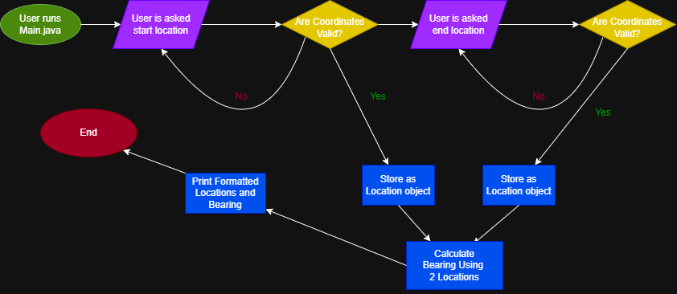

# Direction-Finder-MVP

Finds the direction of the displacement of 2 Locations.

## The Problem

The map apps and their directions have always been confusing to me and people I know. I have found myself walking in the opposite direction several times. Several times my dad passes the entrance to restaurant because the map defaults to "You're here" when you get too close to the destination.

## How It Works

- Ask users for 2 Locations, start and end, in the format of "(Latitude, Longitude)" (Which is how google map represents the geolocation)
- Using the Initial Bearing Formula, calculates the direction
- Outputs "Direction from [Start] to [End]: [Bearing]° [Compass Reference]"



## Tech Stack

- **Language:** Java
- **Libraries:** java.lang.IO, java.lang.Math, java.lang.String
- **External tools:** cron, curl, APIs, etc.

## Setup

```java
git clone https://github.com/your-username/direction-finder.git
cd direction-finder
javac Main.java Location.java Bearing.java
```

## Usage

How to actually run the thing, with examples.

```java
java Main
```

## Roadmap

Features you haven't built yet but plan to (pull these from your
"Schedule" quadrant in the Eisenhower Matrix).

- [ ] Move to Html
- [ ] Implement Google API and Widget
- [ ] Add Arrow that points to direction determined on devices with Orientation Features

## Author

Thevin Jayawardena, https://github.com/tjayawa
